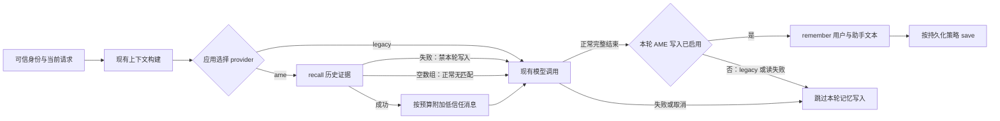

# AME Java SDK 通用集成指南

适用版本：`io.ame:ame-java:3.0.0-rc.2`（classifier：`linux-x86_64`），Linux x86_64、Java 17+，JNI ABI 1。本文面向已有 Java Agent，在 Agent 进程内读写长期记忆，不绑定行业、模型供应商或 Web 框架。

完整方法、参数和 JSON 契约见 [接口参考](API.md)；可编译源码和运行命令见 [示例](../examples/README.md)。provider、回退策略和模型回调属于应用适配层，不是 JAR 自带接口。

## 1. 交付物与接入条件

| 项目 | 约定 |
|---|---|
| Java 类 | `io.ame.AmeEngine`，实现 `AutoCloseable` |
| Maven 依赖 | `io.ame:ame-java:3.0.0-rc.2`，classifier `linux-x86_64` |
| 运行环境 | Linux x86_64、Java 17+、与 SO 兼容的 glibc |
| Java 运行依赖 | SDK 没有第三方 Java 运行依赖；JSON 解析沿用应用自己的库 |
| 运行方式 | 同进程 JNI 调用；没有 HTTP 地址、服务端口或模型 key |
| 数据位置 | 应用传入的本地目录，主要快照为 `graph.json` |
| 当前 JAR | `ame-java-3.0.0-rc.2-linux-x86_64.jar`，含 `io/ame/native/linux-x86_64/libame_jni.so` |

AME 提供记忆写入和检索证据，应用继续负责用户鉴权、当前上下文、业务规则、模型调用及回答输出。当前 Java API 使用内置规则提取和默认向量实现，没有 embedding/提取器注入、模型调用或远程存储配置入口。

从仓库根目录执行 `sh .cloudbuild/build.sh`，得到 `build/cloudbuild/artifacts/ame-java-linux-x86_64.tar.gz` 及校验文件。解包后使用其中的 JAR 和配套 POM。完整构建、解包与校验命令见 [SDK README](../README.md)。构建不强制 glibc 2.36，默认记录实际所需符号版本；可显式配置 `AME_MAX_GLIBC` 执行上限检查。面向更老的 Linux 时须使用匹配目标的构建环境重新产包。实际 SO 要求、构建和测试证据见归档 `metadata/build.json` 的 `required_glibc` 及 [Linux 验证记录](LINUX-VALIDATION.md)。部署前仍需在目标镜像、临时目录权限和数据卷上验收。

## 2. 引入依赖

团队 Maven 仓库已有该 JAR/POM 后，应用声明：

```xml
<dependency>
  <groupId>io.ame</groupId>
  <artifactId>ame-java</artifactId>
  <version>3.0.0-rc.2</version>
  <classifier>linux-x86_64</classifier>
</dependency>
```

Gradle 对应声明：

```groovy
dependencies {
    implementation 'io.ame:ame-java:3.0.0-rc.2:linux-x86_64'
}
```

该坐标不表示已经发布到 Maven Central。仓库地址和凭据沿用团队配置；收到归档后，也可在解包目录先安装到本地仓库：

```sh
mvn install:install-file \
  -Dfile=ame-java-3.0.0-rc.2-linux-x86_64.jar \
  -DpomFile=ame-java-3.0.0-rc.2.pom \
  -Dclassifier=linux-x86_64
```

本地安装只影响当前机器，CI/其他 Agent 仍需拿到同一构件。团队发布也必须保留 classifier，并记录 JAR SHA256 与验证结果；不能覆盖旧的无 classifier 坐标。

首次 `open` 先校验当前 JVM 为 Linux x86_64，再从 JAR 提取 SO 到 `java.io.tmpdir`。需要外置库时，在首次 `open` 前指定 JVM 属性：

```sh
java -Dame.native.path=/absolute/path/libame_jni.so -jar your-agent.jar
```

`ame.native.path` 优先于 JAR 内 SO，但不能绕过平台检查；配置错误会报错，不会自动换用 JAR 资源。运行环境需要允许加载 native 库，SO 的 ABI 和系统运行时必须匹配。

## 3. 一轮 Agent 请求的集成位置



建议保留现有上下文构建器，AME 作为附加证据来源。不要用 recall 结果替换系统规则、当前问题、图片/工具参数，也不要自动把旧对话当作可信事实或可执行指令。应用用自己的 JSON 库解析数组，选择 `text` 等所需字段，限制条数和输入预算，再作为独立低信任消息交给现有模型。`score` 是排序值，不是事实可信度或概率。

以下是 AME 已启用时的接入顺序；legacy 请求直接使用现有模型链路，不执行 AME 读写：

1. 从鉴权结果得到可信租户/用户作用域，取得该作用域复用的引擎实例。
2. 构建原有 prompt，再用当前问题调用 `recall(query, limit)`。没有结果或读失败时继续使用原有 prompt。
3. 调用现有模型一次。模型失败按原业务错误路径处理，不能因记忆回退重新调用模型。
4. 仅在本轮读取没有失败、模型正常完整结束后，将用户输入和最终助手文本分别 `rememberTurn`；两条使用各自消息 ID，同一个业务 session ID。正常空数组不禁写。
5. 按选定策略 `save()`，并在作用域回收/应用关闭时显式 `close()`。

用户和助手两次 remember **不是事务**。一次写入失败前可能已有部分内存状态改变；相同 messageId 再次调用也不保证去重。因此不能把整轮模型或两次写入无条件重试。需要幂等时，由应用在调用边界维护请求状态与去重策略；外部去重状态与两次 remember/save 无法通过此 SDK 原子提交，仍需定义崩溃和部分写入后的恢复规则，不能据此承诺 exactly-once。

## 4. 可插拔与回退

由应用定义自己的上下文扩展接口；保留已有实现为 `legacy`，另加 AME 适配器。示例中的 `ContextProvider` 仅演示这个模式，不要求应用采用其类名或替换已有接口。

| 情况 | 建议应用行为 |
|---|---|
| 配置为 legacy | 使用原有上下文；不创建 AME 引擎、不加载 native library |
| AME 初始化失败 | 根据业务策略明确告警后回退 legacy；需要强制记忆的业务可选择启动失败 |
| 本轮 recall 失败 | 使用原有上下文并跳过本轮 AME 写入；记录记忆降级，不把它计为有效召回 |
| recall 返回 `[]` | 正常无匹配结果，不属于故障 |
| 模型调用失败/流被取消 | 沿用模型错误或取消流程，不触发本轮成功写入钩子 |
| remember/save 失败 | 记录持久化失败，保留已生成回答；不要重试模型，也不要宣称本轮记忆已可靠保存 |
| close 保存失败 | 记录错误；对象已关闭、句柄已释放，不能再用该对象补 save |

读失败、写失败和模型失败应分开捕获。不要在整个“召回 → 模型 → 写入”链外统一重跑任务，也不要把 `OutOfMemoryError` 等进程错误伪装成可选记忆故障。native 加载失败是 `UnsatisfiedLinkError`，可仅在可选插件初始化边界单独处理。

回退 legacy 只切换应用行为，不自动把 AME 历史迁移为旧上下文，也不删除 AME 数据。配置在启动时选择还是运行时切换由应用实现；示例使用启动时选择，切换后需重新启动。SDK 本身没有 provider 开关、自动回退或热切换 API。

## 5. 用户、会话与引擎生命周期

- **目录是隔离边界。** 每个需要隔离的租户/用户使用独立目录；应用可对规范化可信 namespace 做 SHA256 后作为目录名。哈希只避免路径拼接问题，不能替代鉴权。
- **sessionId/messageId 是来源标记。** `recall` 没有用户、租户或 session 过滤参数。把不同用户写到同一目录，再传不同 sessionId，并不能实现用户隔离。若业务要求会话间也隔离，应将 session 纳入目录作用域。
- **复用实例。** 不要每个请求都 open/close；open 会加载快照，close 会全量保存。示例在单个可信作用域内复用一个实例；生产需要按使用量设计有界缓存与回收。
- **一个目录同时只允许一个打开者。** SDK 使用 `.ame.lock` 独占锁拒绝重复打开，包括不同进程。多副本部署应按作用域路由到唯一所有者；共享一个目录不能自动获得多副本一致性。
- **没有自动资源回收承诺。** 使用 `try-with-resources`、应用关闭回调或明确的租约回收逻辑。不要依赖 GC/finalizer 保存记忆。

同一 `AmeEngine` 的方法串行执行；这不等于多方法事务。不同用户可以使用不同引擎实例，应用不必额外用一把全局锁串行所有用户。管理实例缓存时仍需保证：活跃请求持有的引擎不会被淘汰关闭，同目录不会竞争创建多个实例。

## 6. 同步、流式和响应式工程的适配

| 工程形态 | 接入方式 |
|---|---|
| 普通 Java/线程池服务 | 在请求工作线程中调用同步 API，复用引擎，显式关闭 |
| Spring MVC 等阻塞服务 | 应用管理 provider/引擎生命周期；已有模型调用前后接两个钩子即可 |
| Reactor/WebFlux | 将 open/recall/remember/save/close 安排到有界工作线程，不能阻塞事件循环 |
| SSE/流式回答 | 累积本轮正常输出，在成功完成时写最终文本；取消/异常不调用成功写入钩子 |

SDK 没有异步、deadline 或 cancel 参数。上层 `timeout`/线程中断只限制上层等待，**不等于停止正在执行的 C++ 操作**。超时后后台写入可能仍在进行，不能立即重试、销毁目录或再次打开同目录实例。排队容量、超时、失败指标和引擎回收顺序由应用管理。

示例使用同步调用以展示边界，没有实现生产调度器、流式取消或并发缓存，不应直接当作高并发服务容器。已有文旅工程采用的 Spring `ContextProvider` 和可信 Reactor Context 属于该工程适配层，不属于通用 JAR。

## 7. 持久化与性能选择

`rememberTurn` 成功表示引擎完成写入处理，不表示已持久化。`save` 保存完整快照；`close` 也会保存。根据业务选择：

| 策略 | 代价和边界 |
|---|---|
| 每轮完成后 save | 易理解；每轮承担全量保存时间，成本随历史量增长 |
| 应用批量/定时 save | 可减少频繁保存；未保存窗口内的数据在崩溃时可能丢失，应用负责调度和关闭 flush |

SDK 当前没有可配置后台 flush、WAL、事务、逐条删除、导出迁移或分布式存储接口；不要把这些策略配置当作已提供功能。`save` 也不承诺断电级 durability；故障恢复要求需在目标存储环境验证。

## 8. 最小接入验收

先运行真实 JAR 的 `SdkQuickStart`，确认中文/emoji 写入、召回和关闭重开均通过；再运行 `PluggableAgentExample` 的 legacy、ame 及初始化失败回退场景。示例模型是明确标注的本地回调，不调用真实 LLM，也不声称验证回答质量。

接入目标工程后至少核对：实际 payload 中有预期历史、原上下文保持、每请求模型只调用一次、异常/取消不会触发成功写入、不同可信作用域不互读，以及应用关闭后能重开快照。SDK 的 Linux 验证不替代目标应用、部署镜像、存储与真实模型的集成验收；可运行示例的验证环境与范围见 [示例记录](../examples/README.md)。
